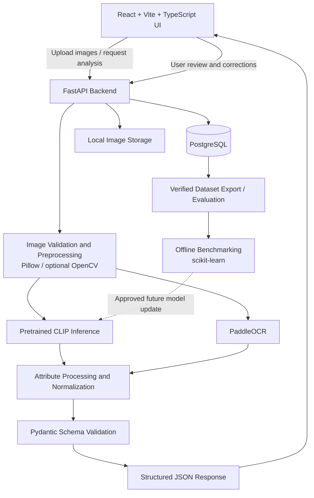

## Related documentation

- [PRD](./PRD.md) — product goals, scope, and success metrics
- [Decisions](./Decisions.md) — architectural context and open implementation decisions
- [UI Requirements](./UI_Requirements.md) — product review and user workflow expectations
- [Milestones](./Milestones.md) — delivery phases and release acceptance criteria
- [System Overview](../docs/system-overview.md) — simplified walkthrough for new project contributors

## 1. Proposed Technology Stack (Locked)

| Layer | Technology | Responsibility |
|---|---|---|
| Frontend | React + Vite + TypeScript | Upload UI, results, attribute editing, review and approval |
| Styling | Tailwind CSS | Consistent, responsive UI styling |
| Backend API | Python + FastAPI | Upload validation, workflow orchestration, API responses |
| Visual model | Hugging Face Transformers + pretrained CLIP | Zero-shot category and attribute candidate scoring baseline |
| ML / inference framework | PyTorch | Model inference and possible future fine-tuning |
| OCR | PaddleOCR | Text detection and recognition from visible labels |
| Image utilities | Pillow; OpenCV where needed | File decoding, image validation, resizing, color conversion and image preparation |
| Schema validation | Pydantic | Validate request/response and normalized metadata fields |
| Database | PostgreSQL | Product, image-reference, prediction, review and evaluation records |
| Flexible attributes | PostgreSQL JSONB | Store category-specific attribute values while preserving a consistent core schema |
| Metrics | scikit-learn | Accuracy, precision, recall, F1 and confusion-matrix evaluation |
| Initial file storage | Local filesystem for development | Store uploaded images and save their paths/references in PostgreSQL |

## 2. High-Level System Architecture



### Processing flow

1. The user selects one or more images for the same product.
2. FastAPI validates file types, sizes, and image decodability.
3. Pillow prepares images for model inference. OpenCV is used only if an additional image-processing need is demonstrated.
4. CLIP compares image representations with curated candidate category/attribute descriptions and returns candidate scores.
5. PaddleOCR detects and reads text visible in the images.
6. Attribute processing maps raw candidates to approved vocabulary values, resolves or flags conflicts across images, and preserves unknown values when evidence is insufficient.
7. Pydantic validates the structured metadata response.
8. The UI displays predictions with confidence/evidence where available.
9. The user accepts, edits, or marks fields as unknown.
10. The final approved values and a record of the prediction/review are saved in PostgreSQL. Image files remain in the configured file storage.
11. Verified examples can be exported for offline evaluation and future model experiments. Model changes require evaluation before deployment.

## 3. Attribute and Category Design

### 3.1 Initial candidate attributes

| Attribute | Expected evidence | MVP handling |
|---|---|---|
| Category | Overall visual appearance and candidate category comparison | Required; return the best-supported category and a confidence score where available |
| Color | Visual appearance | Normalize to a controlled vocabulary; allow multiple colors if needed |
| Pattern | Visual appearance | Controlled vocabulary such as solid, striped, checked, floral, printed, or unknown |
| Apparel type | Visual appearance and category mapping | Normalize types such as T-shirt, shirt, jeans, dress, jacket, or footwear type |
| Sleeve type / neckline | Visible garment details | Optional category-dependent attributes; permit unknown |
| Brand | Readable printed text or label; user-provided verified information | OCR may suggest a value; do not claim verified identity solely from an uncertain OCR result |
| Material | Readable fabric label or verified seller/product information; visual evidence only as a weak clue | Do not assert exact textile composition from appearance alone; allow unknown pending verification |

The exact required fields and vocabulary should be configured in a versioned attribute schema. Not every attribute applies to every category.

### 3.2 Suggested normalized response

```json
{
  "product_id": "generated-product-id",
  "category": {
    "value": "T-shirt",
    "confidence": 0.87,
    "source": "clip",
    "status": "suggested"
  },
  "attributes": {
    "color": {
      "value": "Blue",
      "confidence": 0.91,
      "source": "visual_model",
      "status": "suggested"
    },
    "pattern": {
      "value": "Solid",
      "confidence": 0.76,
      "source": "visual_model",
      "status": "suggested"
    },
    "brand": {
      "value": null,
      "confidence": null,
      "source": "ocr",
      "status": "unknown"
    },
    "material": {
      "value": null,
      "confidence": null,
      "source": "not_observed",
      "status": "unknown"
    }
  },
  "review_status": "pending"
}
```

The confidence values above are illustrative only; they are not measured performance values. A CLIP similarity score is not automatically a calibrated probability. Confidence thresholds must be selected using validation data.

### 3.3 Multiple-image behavior

- Treat the uploaded images as views of one product, not as separate products, unless the user explicitly starts a separate product submission.
- Run inference per image and combine candidate evidence using a documented aggregation rule.
- If images disagree on color, brand text, or another field, flag the field for review instead of hiding the conflict.
- Avoid counting multiple photos of the same product as independent evaluation examples.

## 4. API Outline

The following is a proposed contract, to be finalized during implementation.

| Method | Endpoint | Purpose |
|---|---|---|
| `POST` | `/api/v1/products/analyze` | Upload one or more images and receive candidate metadata |
| `GET` | `/api/v1/products/{product_id}` | Retrieve the latest product record and review state |
| `PATCH` | `/api/v1/products/{product_id}/review` | Save user corrections and approval status |
| `GET` | `/api/v1/health` | Check API service health |
| `GET` | `/api/v1/taxonomy` | Return supported categories and attribute vocabularies |

API rules:
- Use multipart form upload for images.
- Return a stable product identifier and structured category/attribute fields.
- Distinguish request validation errors, unsupported file types, inference failures, and persistence failures.
- Add authentication and authorization before exposing the API publicly.

## 5. Proposed Data Model

PostgreSQL should use relational columns for core fields and JSONB for flexible attributes.

### `products`
- `id` — primary key
- `category` — normalized category
- `attributes` — JSONB normalized attribute object
- `review_status` — pending, approved, or needs_review
- `schema_version` — attribute schema version
- `created_at`, `updated_at`

### `product_images`
- `id` — primary key
- `product_id` — foreign key to products
- `storage_path` — generated path or storage reference
- `original_filename` — optional display/debug metadata, never used as a storage path
- `content_type`, `file_size`, `created_at`

### `prediction_runs`
- `id` — primary key
- `product_id` — foreign key to products
- `model_name`, `model_version` or configuration identifier
- `raw_candidates` — JSONB, including scores and OCR results where appropriate
- `processing_status`, `processing_time_ms`, `created_at`

### `review_events`
- `id` — primary key
- `product_id` — foreign key to products
- `original_prediction` — JSONB snapshot
- `reviewed_values` — JSONB approved/corrected values
- `reviewer_identifier` — optional for local MVP; avoid storing unnecessary personal information
- `created_at`

The physical schema may be refined during implementation. Add indexes for common product lookups and relevant JSONB queries only as needed.
