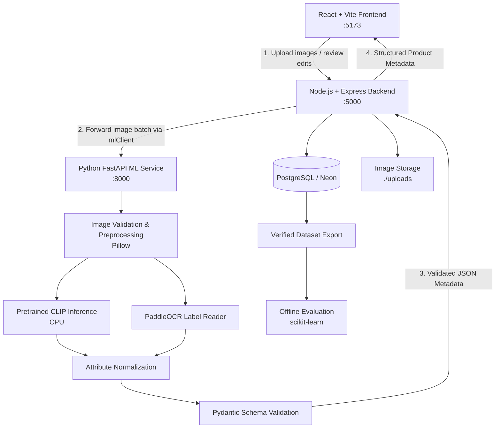

## Related documentation

- [PRD](./PRD.md) — product goals, scope, and success metrics
- [Decisions](./Decisions.md) — architectural context and open implementation decisions
- [UI Requirements](./UI_Requirements.md) — product review and user workflow expectations
- [Milestones](./Milestones.md) — delivery phases and release acceptance criteria
- [System Overview](../docs/system-overview.md) — simplified walkthrough for new project contributors

## 1. Locked Technology Stack (3-Tier Service Architecture)

| Layer | Technology | Responsibility |
|---|---|---|
| **Frontend** | React + Vite | Multi-image upload UI, preview, real-time prediction display, editing, and review approval |
| **Styling** | Tailwind CSS | Consistent, responsive, accessible UI styling |
| **Backend API / BFF** | Node.js + Express | Upload validation, file persistence, workflow orchestration, database queries, and client API |
| **ML Client Integration** | `mlClient.js` (Axios / FormData) | Express integration client communicating with the Python ML service |
| **ML Inference Service** | Python + FastAPI | Vision & OCR inference microservice exposing prediction and health endpoints |
| **Visual Baseline** | Hugging Face Transformers + Pretrained CLIP | Zero-shot category and attribute candidate scoring on CPU |
| **ML Framework** | PyTorch (CPU) | Model inference and possible future fine-tuning |
| **OCR** | PaddleOCR | Text detection and recognition from visible garment labels |
| **Image Utilities** | Pillow (PIL) | File decoding, image validation, resizing, and batch preparation |
| **Schema Validation** | Pydantic (Python) | Strict schema validation for prediction outputs and taxonomy |
| **Database** | PostgreSQL (Neon) | Product records, image references, prediction runs, and human review events |
| **Flexible Attributes** | PostgreSQL JSONB | Category-specific attribute values alongside consistent relational keys |
| **Metrics & Evaluation** | scikit-learn | Accuracy, macro precision, recall, F1, and confusion matrix benchmarking |
| **File Storage** | Local filesystem (`./uploads`) / Neon Object Storage | Store uploaded product images and save verified paths in PostgreSQL |

## 2. High-Level System Architecture



### Processing flow

1. **Upload & Ingestion:** The seller uploads one or more images for the same fashion product in the React frontend.
2. **Backend Validation:** Node.js Express backend validates file formats (JPEG, PNG, WEBP), file sizes, and count, saving files with secure UUIDs to `./uploads`.
3. **ML Service Invocation:** `mlClient.js` forwards the image batch to the Python ML service (`POST /api/v1/predict`).
4. **Visual & OCR Inference:**
   - Pillow verifies and decodes the image batch into memory.
   - Pretrained CLIP compares images against category and attribute candidate prompts on CPU.
   - PaddleOCR extracts readable text from labels/tags as corroborating evidence.
5. **Metadata Assembly & Validation:** Predictions are normalized against the controlled taxonomy and validated by Pydantic before returning to the Node.js backend.
6. **Presentation & Review:** The frontend renders predictions with clear confidence badges.
7. **Human Approval & Dual Persistence:** The seller reviews, modifies values, or marks fields unknown. The Express backend saves the final approved product while preserving the original AI prediction run in a separate audit table.

## 2.1 Locked Repository Directory Structure

```text
project-root/
│
├── frontend/                   # React + Vite Client
│   ├── public/                 # Static assets (favicons, icons)
│   ├── src/
│   │   ├── assets/             # Brand logos, SVGs, static media
│   │   ├── components/         # Reusable UI components (Navbar, ConfidenceBadge)
│   │   ├── features/           # Feature-specific modules (upload, review, metadata)
│   │   ├── pages/              # Page views (DashboardPage)
│   │   ├── layouts/            # Page shell layouts (MainLayout)
│   │   ├── hooks/              # Custom React hooks (useProductAnalysis)
│   │   ├── services/           # Backend API integration (Axios client)
│   │   ├── context/            # Global state context (ProductContext)
│   │   ├── utils/              # Client-side formatters and helpers
│   │   ├── App.jsx             # Root application component
│   │   └── main.jsx            # React DOM bootstrap
│   ├── package.json
│   ├── vite.config.js
│   ├── tailwind.config.js
│   └── .env.example
│
├── backend/                    # Node.js + Express API & BFF
│   ├── src/
│   │   ├── config/             # Database, port, and service URLs
│   │   ├── modules/
│   │   │   ├── auth/           # Authentication / session controller (open MVP)
│   │   │   ├── users/          # User profile / role controller
│   │   │   └── products/       # Product upload, analysis, review controller & service
│   │   ├── middleware/         # Upload (Multer) and global error handling
│   │   ├── integrations/
│   │   │   └── mlClient.js     # HTTP client for Python ML microservice
│   │   ├── utils/              # Logging and helper utilities
│   │   ├── app.js              # Express app setup and middleware pipeline
│   │   └── server.js           # HTTP listener entrypoint
│   ├── tests/                  # Backend unit and integration tests (Jest/Supertest)
│   ├── package.json
│   └── .env.example
│
├── ml/                         # Python / ML Service
│   ├── src/
│   │   ├── api/                # FastAPI routers (/health, /taxonomy, /predict)
│   │   ├── data/               # Taxonomy, controlled vocabularies, Pydantic schemas
│   │   ├── preprocessing/      # Image validation and batch decoding (Pillow)
│   │   ├── models/             # CLIP model wrapper and loader
│   │   ├── inference/          # Prediction pipeline (candidate scoring & fusion)
│   │   ├── training/           # Fine-tuning pipelines (deferred until benchmark need)
│   │   ├── evaluation/         # Scikit-learn evaluation metrics (accuracy, F1)
│   │   ├── pipelines/          # End-to-end ML workflow orchestration
│   │   └── main.py             # FastAPI entrypoint
│   ├── tests/                  # Pytest test suite (health, schemas, taxonomy)
│   ├── requirements.txt
│   └── .env.example
│
├── docs/                       # Architecture diagrams and system walkthroughs
├── scripts/                    # Development launchers (start-dev.bat, start-dev.sh)
├── context/                    # Durable project requirements, memory, and progress tracker
├── .gitignore                  # Git ignore rules for Node, Python, and uploads
└── README.md                   # Repository overview and quickstart guide
```

## 3. Attribute and Category Design

### 3.1 Initial candidate attributes

| Attribute | Expected evidence | MVP handling |
|---|---|---|
| Category | Overall visual appearance and candidate category comparison | Required; return the best-supported category and a confidence score where available |
| Color | Visual appearance | Normalize to a controlled vocabulary; allow multiple colors if needed |
| Pattern | Visual appearance | Controlled vocabulary such as solid, striped, checked, floral, printed, or unknown |
| Apparel type | Visual appearance and category mapping | Normalize types such as T-shirt, shirt, jeans, dress, jacket, or footwear type |
| Sleeve type / neckline | Visible garment details | Optional category-dependent attributes; permit unknown |
| Brand | Readable printed text or label; user-provided verified information | OCR may suggest a value; do not claim verified identity solely from an uncertain OCR result |
| Material | Readable fabric label or verified seller/product information; visual evidence only as a weak clue | Do not assert exact textile composition from appearance alone; allow unknown pending verification |

The exact required fields and vocabulary should be configured in a versioned attribute schema. Not every attribute applies to every category.

### 3.2 Suggested normalized response

```json
{
  "product_id": "generated-product-id",
  "category": {
    "value": "T-shirt",
    "confidence": 0.87,
    "source": "clip",
    "status": "suggested"
  },
  "attributes": {
    "color": {
      "value": "Blue",
      "confidence": 0.91,
      "source": "visual_model",
      "status": "suggested"
    },
    "pattern": {
      "value": "Solid",
      "confidence": 0.76,
      "source": "visual_model",
      "status": "suggested"
    },
    "brand": {
      "value": null,
      "confidence": null,
      "source": "ocr",
      "status": "unknown"
    },
    "material": {
      "value": null,
      "confidence": null,
      "source": "not_observed",
      "status": "unknown"
    }
  },
  "review_status": "pending"
}
```

The confidence values above are illustrative only; they are not measured performance values. A CLIP similarity score is not automatically a calibrated probability. Confidence thresholds must be selected using validation data.

### 3.3 Multiple-image behavior

- Treat the uploaded images as views of one product, not as separate products, unless the user explicitly starts a separate product submission.
- Run inference per image and combine candidate evidence using a documented aggregation rule.
- If images disagree on color, brand text, or another field, flag the field for review instead of hiding the conflict.
- Avoid counting multiple photos of the same product as independent evaluation examples.

## 4. API Outline

The following is a proposed contract, to be finalized during implementation.

| Method | Endpoint | Purpose |
|---|---|---|
| `POST` | `/api/v1/products/analyze` | Upload one or more images and receive candidate metadata |
| `GET` | `/api/v1/products/{product_id}` | Retrieve the latest product record and review state |
| `PATCH` | `/api/v1/products/{product_id}/review` | Save user corrections and approval status |
| `GET` | `/api/v1/health` | Check API service health |
| `GET` | `/api/v1/taxonomy` | Return supported categories and attribute vocabularies |

API rules:
- Use multipart form upload for images.
- Return a stable product identifier and structured category/attribute fields.
- Distinguish request validation errors, unsupported file types, inference failures, and persistence failures.
- Add authentication and authorization before exposing the API publicly.

## 5. Proposed Data Model

PostgreSQL should use relational columns for core fields and JSONB for flexible attributes.

### `products`
- `id` — primary key
- `category` — normalized category
- `attributes` — JSONB normalized attribute object
- `review_status` — pending, approved, or needs_review
- `schema_version` — attribute schema version
- `created_at`, `updated_at`

### `product_images`
- `id` — primary key
- `product_id` — foreign key to products
- `storage_path` — generated path or storage reference
- `original_filename` — optional display/debug metadata, never used as a storage path
- `content_type`, `file_size`, `created_at`

### `prediction_runs`
- `id` — primary key
- `product_id` — foreign key to products
- `model_name`, `model_version` or configuration identifier
- `raw_candidates` — JSONB, including scores and OCR results where appropriate
- `processing_status`, `processing_time_ms`, `created_at`

### `review_events`
- `id` — primary key
- `product_id` — foreign key to products
- `original_prediction` — JSONB snapshot
- `reviewed_values` — JSONB approved/corrected values
- `reviewer_identifier` — optional for local MVP; avoid storing unnecessary personal information
- `created_at`

The physical schema may be refined during implementation. Add indexes for common product lookups and relevant JSONB queries only as needed.
